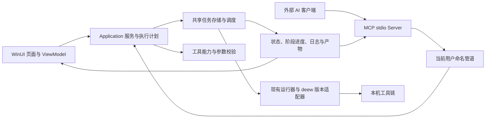

# FlowEncode 3.0 调研与施工计划

调研日期：2026-11-12（Asia/Shanghai）。本文是施工建议与验收基线，尚未实施功能改造或合并 PR。

版本边界（2026-11-12 确定）：**2.0.2 为 2.0 系列最后一个补丁版本，也是最后一个支持旧版 deew 3.x / DEE 5.2.1 工具链的版本。后续开发全面进入 3.0，迁移到 deew 5.x；3.0 不再维护旧版执行路径。** 检测到旧版工具时仍应明确提示不受支持，并引导用户迁移或继续使用 2.0.2。

## 1. 建议结论

**施工主线：稳定基线与复用修复 → 抽出共享任务服务 → deew 5.x → MCP 核心闭环 → 新 UI 落地 → 升级与发布验收。**

UI 的信息架构、视觉探索和页面原型可以从第一阶段开始；绑定新接口的页面施工应等任务、音频能力和执行计划契约稳定后展开。MCP 的只读接入也可以提前验证。

- deew 升级是音频后端适配工程，需要覆盖工具检测、DEE 目录导入、配置、参数、进度与产物落盘。
- [PR #18](https://github.com/frankie1024/FlowEncode/pull/18) **有价值，应复用**。保留协议、工具定义、桥接、发布接入和有用的修复；将调度与业务逻辑逐步移出 ViewModel，并补齐下述缺口。
- 3.0 继续使用 WinUI 3。已有主题资源和公共控件可以支撑焕新；当前没有足够理由把跨 UI 框架重写加入关键路径。
- 3.0 的自然语言入口先采用“外部 AI 客户端调用 FlowEncode MCP Server”。在 FlowEncode 内嵌聊天、模型供应商接入和密钥管理属于独立产品范围，建议后续版本评估。
- 以可验证的任务闭环为发布目标，不以暴露工具数量作为完成标准。

## 2. 调研范围与验证边界

| 项目 | 本次依据 |
| --- | --- |
| 调研起始基线 | 本地 HEAD `ae1a59709f4cae9f8f4d7472fd6f508129200716`，2.0.1 |
| PR | #18，头提交 `8c2d7e3e8fccbc62489fcd6726c30ee80b1299f5`；69 个文件，+7247 / -294 |
| PR 构建测试 | 导出到独立临时目录，以锁定依赖运行测试，394/394 通过；测试引用 MCP 项目，因此同时编译了该项目 |
| 命令 | `dotnet test FlowEncode/FlowEncode.Domain.Tests/FlowEncode.Domain.Tests.csproj --configuration Debug --nologo --verbosity minimal --filter "TestCategory!=ExternalToolSmoke" -p:RestoreLockedMode=true` |
| 外部工具验证 | 本次没有执行真实编码、DEE/Atmos、VapourSynth 渲染、解复用或安装器端到端测试 |
| UI 依据 | XAML、公共资源、导航与现有仓库截图；未启动当前应用进行交互可用性测试 |
| GitHub 状态 | 查询时 PR 为 OPEN、MERGEABLE，但 mergeStateStatus=BLOCKED，statusCheckRollup 为空；不将其视为 CI 已通过 |

调研开始时工作区已有设置与 PATH 集成相关未提交修改，本次未改动这些文件。结束核对时，它们已出现在提交 `75ec377`（`feat(settings): add one-click system PATH registration`）中。PR 测试针对独立导出的 PR 快照，不代表它与该新提交组合后的结果；P0 应以届时的最新基线复核集成。

## 3. 为什么先做共享服务

仓库已有 Domain、Application、Infrastructure 和 WinUI 层，适合渐进调整。主要问题是任务生命周期、模块状态与调度仍较多存在于 `MainWindowViewModel` 的各个 partial 文件中。

PR 为解决“双队列”问题，让 MCP 经命名管道调用桌面端。这条方向正确，但目前 `DesktopAutomationHost` 持有 `MainWindow`，请求转到 UI 线程执行，再操作 ViewModel。若先完成新 UI，再将 MCP 接入同样的 ViewModel，后续抽取业务层会同时返工两套入口。

建议目标结构如下，接口名称为拟议名称：

不需要为此新建常驻后台服务：桌面进程仍持有任务，MCP 是轻量入口；AI 客户端断开不取消已经接受的编码任务。关闭桌面进程的语义则继续按应用自身的任务关闭策略执行。

最小共享契约：

| 契约 | 职责 |
| --- | --- |
| `TaskRecord` / `TaskSnapshot` | 各类任务统一 ID、类型、来源（手动/MCP）、状态、阶段、日志、错误与产物引用 |
| `ITaskCoordinator` | 提交、开始、取消、重试、排序、查询；集中处理输出占用与并发规则 |
| `ExecutionPlan` | 已解析工具路径、源轨道、有效参数、预期输出清单、能力检查及实际命令 |
| `IToolCapabilityService` | 版本、可用格式、模式、必需组件和不可用原因；UI 与 MCP 共用 |
| `OutputArtifact` | 区分单文件、目录和多文件产物，避免把 DDP 输出目录误当输出文件 |

共享任务中心不意味着各工具必须采用同一种并发数。保留按任务类型或工具限制并发的能力，集中控制 CPU/磁盘资源，避免“视频队列满载但模块任务继续无约束启动”。初期可采用保守的固定上限，无需先建设复杂资源调度器。

## 4. deew 5.x 的影响与范围

### 4.1 版本目标

调研时上游最新发布已是 **5.1.0**，发布于 UTC 2026-11-11 22:02，即北京时间 **2026-11-12 06:02**。它继续调整 dialnorm 与 7.1 测量行为。因此工程命名建议使用“deew 5.x 适配”，首批以 5.0.3 和 5.1.0 建立回归样本，发布时固定经过真实验证的推荐版本，不追随浮动 latest。

来源：[5.1.0 发布说明](https://github.com/pcrlnd/deew/releases/tag/5.1.0)。

### 4.2 必须处理的变化

| 变化 | 当前实现的影响 | 施工动作 |
| --- | --- | --- |
| DEE 6.7 使用多个 CLI，旧 DEE 5.2.1/XML 接口停止支持 | `DefaultToolRegistryService` 仍主要查找 `dee.exe` 等旧文件名，AudioDdp 就绪判断也依赖这个旧定义 | 以 DEE 工具包目录和具体编码组件检测能力；保留旧版本识别，避免误报“已就绪” |
| 工具在 deew 同目录及 PATH 查找，DEE 在相邻 `dee` 目录 | FlowEncode 当前仅把已选路径的目录拼到子进程 PATH；同目录工具可能抢先命中 | 检查实际解析工具路径，展示版本来源；导入完整 DEE 目录，保留其运行依赖与目录结构 |
| 配置位置与格式变化 | 当前 `DeewConfigCompatibilityLease` 为旧 Python 版修改 `%LocalAppData%/deew/config.toml` | 旧补丁保留在 2.0.2；3.0 的 5.x 适配使用受 FlowEncode 管理的可写工具目录和相邻配置，初始化与备份分离处理 |
| 新增 DDP/Atmos profile；文件后缀可为 `.ec3` / `.eb3` | 当前音频请求只有 Ddp 模式，没有 DDP profile、码率、轨道等结构化选项 | 扩展类型化音频选项，生成明确计划与产物清单；按版本/格式校验组合 |
| 可选 truehdd 与 dee_shim 依赖 | 单个“DDP 可用”布尔状态无法说明模式差异 | 分开呈现普通 DDP、7.1 standard/bluray、Atmos 等能力；缺组件时只禁用受影响选项 |
| 阶段与进度格式改变 | 当前正则主要解析 `Stage progress:` 和 `[DEE: ...]` | 优先接入结构化事件；终端文本用于日志与兼容回退 |

上表的工具、格式与迁移依据：[固定版本 README](https://github.com/pcrlnd/deew/blob/5.0.3/README.md)、[5.0 变更记录](https://github.com/pcrlnd/deew/blob/5.0.3/changelog.md)。

**一个可以直接利用的上游能力：** 5.0.3 源码支持 `DEEW_EVENTS_FILE`，向文件追加 JSONL 事件，包括 `hello`、`jobs`、`progress`、`done`、`warning`、`error` 和交互提示；进度带 job、stage、percent。建议每次调用分配独立事件文件，由 FlowEncode 读取、映射到共享任务状态。它是上游 GUI 使用的源码接口，尚不能视为跨版本冻结的公共协议，须按锁定版本验证；事件文件写入失败可能静默失效，不能单独依赖它判断任务成功。

来源：[events.rs](https://github.com/pcrlnd/deew/blob/5.0.3/src/events.rs)。

**配置初始化也是独立步骤：** 5.0.3 从可执行文件旁读取 `config.toml`；缺配置时自动创建后以退出码 1 结束，当次编码不会继续。首次环境准备需要先初始化配置，不能把第一次编码失败简单归咎于源文件。5.x 配置也不能靠改变 WorkingDirectory 重定向。

来源：[config.rs](https://github.com/pcrlnd/deew/blob/5.0.3/src/config.rs)。

### 4.3 建议分批交付

1. **3.0 必须交付：** 普通 DDP 的 2.0/5.1、7.1 两种 profile，结构化码率/轨道/DRC/dialnorm 选项及合法性校验，环境导入、阶段进度、可预览命令、取消与输出保护。
2. **3.0 可纳入，但受真机验收约束：** DDP Atmos。其 UI 与 MCP 接口同步支持，必须以 TrueHD Atmos 源和授权 DEE 环境验证成功输出、声道与元数据。验收未通过时明确隐藏/禁用该能力。
3. **后续扩展：** TrueHD/TrueHD Atmos、AC4/AC4 Atmos、DEE AAC 的完整界面。架构预留格式能力，不为覆盖全部上游格式拖延基础版本。

建议在 3.0 保留 deew 3.x 旧适配器作为过渡路径：有旧 DEE 的用户可继续完成既有 DDP 工作流，新功能仅在 5.x 下显示；旧路径限于已验证组合，不扩大旧版功能。deew 4.x 单独探测，未验证前不自动归入任一适配器。

### 4.4 deew 验收重点

- 双声道、5.1、7.1；容器内非首条音轨；中文、空格和长路径。
- 缺 DEE、缺特定组件、版本错配、缺配置、配置不可写、用户配置中的输出选项与暂存目录冲突。
- 5.0.x/5.1.x 的 dialnorm 差异、阶段缺失与未知百分比；未知 JSON 事件、半行写入、事件文件不可写。
- 同名文件不覆盖、队列/模块跨入口输出冲突、磁盘满、最终移动失败保留已完成产物。
- 取消杀掉进程树；退出码、产物存在性与基础媒体探测共同决定成功，不能把“100%”或单个 `done` 事件当成功终态。

## 5. PR #18 的复用决策

### 5.1 直接保留或小改后复用

- MCP 使用官方 C# SDK 和 stdio，日志写 stderr，避免污染 JSON-RPC。
- 当前用户与会话隔离的命名管道、客户端启动桌面端、安装位置查找、`--check` 自检。
- 视频参数、模板、探测、命令预览等工具的 schema 和参数构建；这些已覆盖大量基础接入工作。
- 视频任务输出冲突检查，以及对最终落盘失败的恢复文件保护。
- 环境探测并行化、日志裁剪分配优化、媒体探测缓存精确移除等独立修复，结合现有基线回归后先吸收。
- MCP 发布到安装目录的 `mcp` 子目录、锁文件、测试和中英文接入文档。

提取时按主题拆分 diff 并核查依赖，不假定每个提交都能独立 cherry-pick。尤其不要在拆分时漏掉 `OverwriteOutput` 在所有相关运行器中的传递与最终落盘校验。

### 5.2 进入 3.0 前应解决的问题

| 级别 | 源码发现 | 影响与处理 |
| --- | --- | --- |
| P1 | `AudioTools.StartAudioTask` 的 `overwrite=false` 检查明确排除了 DDP；音频请求没有承载覆盖策略，DDP 目录最终落盘又会替换同名文件 | AI 走 DDP 路径可能在默认参数下覆盖既有产物。把覆盖策略与预期产物带入共享服务，并在最终提交文件时强制执行；不能只在 MCP 入口预检查 |
| P1 | 音频、蓝光、自动压制分别经 `StartAutomationAudio/BluRay/AutoCompression` 直接调用模块启动逻辑，各自判断忙闲；只有视频通过 `Jobs` 队列 | 与“全部任务共享队列与并发上限”的宣传不一致。迁移到共享任务记录与调度，统一可见性、输出占用和完成后动作 |
| P1 | `get_task_status` / `cancel_task` 只接受 module，查询或取消当前/上一次任务 | 任务 A 完成后，另一个调用者启动 B；A 的调用者再取消 audio 会取消 B。按稳定 taskId 查询和取消，module 只用于筛选 |
| P2 | `DesktopAutomationHost` 直接持有窗口与 ViewModel，经 UI Dispatcher 调用业务 | 新 UI 改造会牵动自动化入口。把应用命令与查询抽到 Application，UI 线程只处理绑定状态和窗口行为 |
| P2 | 开始视频/音频时生成新 GUID；管道请求只有 method/params，没有提交幂等键与可恢复的接受回执 | 已接受但响应丢失时，AI 重试不能可靠获知原任务；完成后重试可能重复处理。加入 requestId/idempotencyKey，保存提交键到任务的映射 |
| P2 | 预览与执行分别重建请求，读取当时的模板、设置和能力 | 中间状态变化可能造成执行偏离预览。生成 planId 或带有效参数及版本摘要的不可变计划，执行前检查计划是否过期 |

可定位的源码证据（固定 PR 头提交）：

- [AudioTools.cs:46–58](https://github.com/frankie1024/FlowEncode/blob/8c2d7e3e8fccbc62489fcd6726c30ee80b1299f5/FlowEncode/FlowEncode.Mcp/Tools/AudioTools.cs#L46-L58)
- [ExecutionOutputStaging.cs:155–174](https://github.com/frankie1024/FlowEncode/blob/8c2d7e3e8fccbc62489fcd6726c30ee80b1299f5/FlowEncode/FlowEncode.Infrastructure/ExecutionOutputStaging.cs#L155-L174)
- [MainWindowViewModel.Automation.cs:227–270](https://github.com/frankie1024/FlowEncode/blob/8c2d7e3e8fccbc62489fcd6726c30ee80b1299f5/FlowEncode/ViewModels/MainWindowViewModel.Automation.cs#L227-L270)
- [AppTools.cs:34–62](https://github.com/frankie1024/FlowEncode/blob/8c2d7e3e8fccbc62489fcd6726c30ee80b1299f5/FlowEncode/FlowEncode.Mcp/Tools/AppTools.cs#L34-L62)
- [DesktopAutomationHost.cs:65–83](https://github.com/frankie1024/FlowEncode/blob/8c2d7e3e8fccbc62489fcd6726c30ee80b1299f5/FlowEncode/Automation/DesktopAutomationHost.cs#L65-L83)

前三项属于源码可确认的行为缺口；后两项是长任务自动化可靠性需要补齐的设计能力。394 项测试通过不等于这些情形已被覆盖。

### 5.3 MCP 首批闭环

首批重点接通：应用/环境能力、媒体探测、模板、计划预览、任务提交、按 ID 状态/日志/产物查询、取消和重试。其余工具按领域分组注册，脚本编辑、依赖维护和应用更新在基础闭环稳定后逐批接入；沿用 PR 实现时仍须统一权限提示、错误类型与任务语义。

推荐调用链：`探测 → 选择模板/参数 → 生成计划 → 查看输出与命令 → 提交计划 → 按 taskId 跟踪 → 检查产物`。模型负责理解用户意图，FlowEncode 负责确定性校验与运行。MCP 工具注解用于描述行为，不能代替实际输出保护。

外部 AI 客户端是 MCP host，FlowEncode 提供 MCP server；此接入本身不需要把模型推理嵌入应用。来源：[MCP 架构说明](https://modelcontextprotocol.io/docs/learn/architecture)。

建议端到端验收用例：

1. “按我保存的 x265 模板，把这个视频压到指定目录”：展示有效模板、参数、实际输出类型，执行后可在桌面查询同一 taskId。
2. “把这个文件的第二条音轨转为 DDP”：明确音频轨道索引、声道、profile 和产物；不默选第一轨。
3. “取消刚才那条任务”：即使期间另一个客户端启动了任务，也只取消指定 taskId。
4. 手动操作与两个 AI 客户端同时提交相同输出：统一拒绝冲突；连接丢失后重试能够找回已接受任务。

必须明确现有功能边界：视频编码产物可能是视频码流，不能把“视频压制完成”描述成“已生成保留全部音轨与字幕的完整容器”。通用自动混流/封装未作为本次新增范围，计划与结果须说明输出包含什么。

## 6. UI/UX 焕新方向

基于现有截图与 XAML，可以确认当前首页以模块入口大卡片为主，导航也按工具分区。3.0 建议突出“当前工作和下一步”，让用户能快速理解 AI 或手动操作正在执行什么。

| 区域 | 建议变化 |
| --- | --- |
| 工作台 | 输入/拖放入口、最近源文件和模板、活动任务、环境阻塞项；压缩纯展示区域 |
| 工作流表单 | 固定“输入 → 输出目标 → 参数 → 执行计划”顺序；常用参数优先，高级参数渐进展开 |
| 任务中心 | 视频、音频、解复用、自动压制统一列表；来源标签、阶段、进度、命令、日志、产物和失败恢复入口 |
| 音频页 | 后端/格式/profile 分清，随能力显示可用选项；解释不可用原因，不让用户提交后才发现缺依赖 |
| MCP 设置 | 展示服务位置、自检、可复制接入配置、连接说明和当前可用能力；由明确开关控制自动化入口 |
| VapourSynth | 保留编辑器与预览核心能力，统一外围工具栏、状态、错误与任务入口 |

视觉层优先调整 `Resources/ThemeResources.xaml`、`App.xaml` 中颜色、字号、间距、圆角和动效 token，再逐页迁移已有 `WorkflowPageShell`、`TaskActionBar`、`TaskStatusPanel`、`CommandPreviewBox` 等公共控件。

原型先覆盖三条关键路径：手动视频编码、deew 音频编码、AI 提交后的任务查看。原型用于及早确定信息层级与交互，再扩到设置、模板和脚本工作区。

UI 验收以实际窗口操作为准：浅/深色、中文/英文、窄窗口、100%/150%/200% 缩放、键盘焦点、高对比度、减少动画，以及任务高频日志刷新时的响应。仅更换截图或 token 不能算 UI/UX 完工。

## 7. 分阶段施工与验收

以下为一名熟悉仓库的主要开发者的粗估，包含实现与相关验证；不含等待授权 DEE、测试素材、用户反馈和外部 CI 的时间。按完整基础范围约 **26–38 个开发日，排期建议预留 6–8 周**，应在共享服务和首个 deew 真机样本完成后重估。

| 阶段 | 估算 | 交付 | 退出条件 |
| --- | --- | --- | --- |
| P0 基线与修复 | 2 日 | 明确本地未提交变更归属；建立 3.0 分支和回归基线；按主题吸收 PR 独立修复；整理真实样本矩阵 | 标准 Release 构建/测试通过；2.0.1 原工作流无新增回归；关键真机环境可用 |
| P1 共享服务与契约 | 5–7 日 | 统一任务模型、产物与执行计划；抽取调度/查询/取消服务；迁移旧 UI 到这些入口；MCP 只读桥接验证 | 四类任务有稳定 ID、统一状态与冲突规则；原 UI 可继续使用；取消不误伤其他任务 |
| P2 deew 5.x | 5–8 日 | DEE 包导入、版本能力探测、配置初始化、5.x 适配器、JSONL 事件、结构化 DDP 参数、旧版不受支持提示 | 推荐版本的真实普通 DDP 路径通过；失败/取消/覆盖/恢复用例通过；未验证能力被禁用 |
| P3 MCP 核心 | 4–6 日 | 复用 PR schema/stdio/管道和发布入口；改接共享服务；补 taskId、计划提交和幂等语义；完成多客户端验收 | 自然语言视频/音频闭环成功；任务在桌面可见且可操作；响应丢失不重复提交 |
| P4 UI 落地 | 7–10 日 | 新工作台、任务中心、工作流表单、音频能力 UI、MCP 设置；其余页面统一视觉 | 三条原型路径与已有功能可操作；多主题/语言/缩放/键盘和持续编码时响应检查通过 |
| P5 Beta 与发布 | 3–5 日 | 2.x 数据迁移/备份、安装/升级/卸载、自检、接入文档、真实工具回归 | 从 2.0.1 升级保留模板/工作目录/工具固定路径；安装包含 MCP 并能连接；成功产物经探测确认 |

并行安排是工作流层面的建议，不要求额外人员：P0/P1 期间做 UI 信息架构和原型；P2 期间固定 MCP 工具契约并验证只读工具；P3 期间可开始已稳定页面的 XAML 施工。不要让写入型 MCP 或新音频 UI 跳过 P1/P2 的业务校验。

建议里程碑：

- **Alpha 1：** 旧界面使用共享服务，deew 5.x 普通 DDP 成功。
- **Alpha 2：** MCP 完成真实编码闭环，多入口使用同一任务记录。
- **Beta：** 新 UI 全量迁移，安装与 2.x 数据升级完成。
- **3.0.0：** 发布矩阵通过；Atmos 等可选能力以独立验收结果决定是否开放。

## 8. 可拆分的施工 PR

1. `fix/output-recovery-and-probes`：吸收 PR #18 的独立修复/优化与对应测试。
2. `refactor/task-contracts`：任务、执行计划、产物与错误模型；不改变现有编码行为。
3. `refactor/shared-task-services`：调度、取消、冲突校验迁到共享服务，旧 UI 接入。
4. `feat/deew5-toolchain`：版本识别、DEE 包导入、配置初始化和能力探测。
5. `feat/deew5-ddp`：命令、JSONL 事件、产物处理、DDP 选项与真机验证。
6. `feat/mcp-core`：复用 #18 的传输和核心工具，接入共享服务及任务 ID。
7. `feat/mcp-reliability`：计划提交、幂等键、断连重试、多客户端和安装自检。
8. `feat/ui-shell-and-task-center`：视觉 token、工作台与任务中心。
9. `feat/ui-workflows`：视频/音频/自动压制/解复用/设置/模板/脚本外围迁移，可按页面继续拆分。
10. `release/3.0-migration-and-validation`：迁移、打包、升级和真实工具验收。

上面是 PR 主题名；实际新建 Git 分支统一使用仓库约定的 `codex/` 前缀。

第一批应从 P0/P1 开始，并同时准备授权 DEE 6.7 与真实音频测试环境。只有模板/参数单元测试、没有成功的真实产物，不满足 deew 与 MCP 的发布条件。
